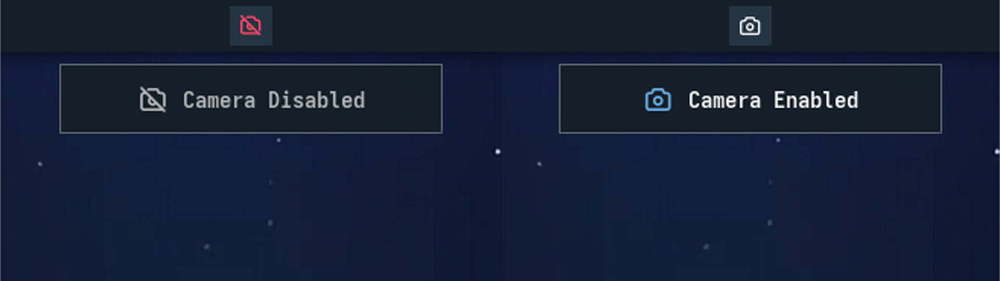

# Lenovo LOQ Camera Switch (Noctalia plugin)

A [Noctalia](https://github.com/noctalia-dev/noctalia) bar widget that shows the
state of the physical camera shutter switch on Lenovo LOQ laptops, and shows the
native OSD when you flip it.

> **Tested on one laptop only: the Lenovo LOQ 15IRX9.** It will probably not
> work on any other laptop without extra work, because the switch state is read
> from a byte of the embedded controller that differs between models.
>
> **Fully vibe-coded** with Claude Code. Read the code before you trust it.
> Details, the one-time root setup and a security note are in the
> [plugin README](lenovo-loq-camera-switch/README.md).

## Install

This repository is a Noctalia plugin source. Add it, then enable the plugin:

    noctalia msg plugins source add augussst git https://github.com/Augussst/lenovo-loq-camera-switch
    noctalia msg plugins enable augussst/lenovo-loq-camera-switch

Then add the **Lenovo LOQ Camera Switch → indicator** widget to your bar and do
the one-time setup from the [plugin README](lenovo-loq-camera-switch/README.md).
I have not tested installing from GitHub this way; the same layout works as a
local source on my machine.
